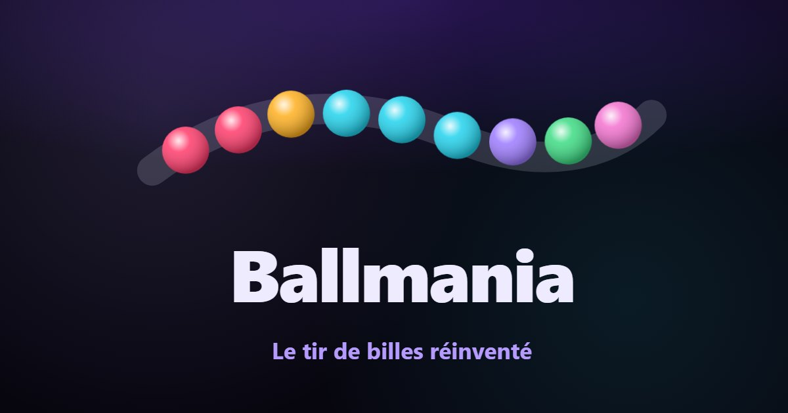

# Ballmania

**Le tir de billes réinventé.** Une chaîne de billes de verre roule vers un trou ; on tire
des billes pour former des groupes de trois et plus qui explosent, et les réactions en
chaîne font le spectacle. Ballmania garde cette prise en main connue de tous et y ajoute
six mondes à mécaniques nouvelles, quatre modes Arcade, des aléas, des améliorations à
débloquer et une destruction soignée.

Jeu web gratuit, sans inscription ni publicité sur ce site, en **français, anglais,
indonésien et russe**, thèmes clair et sombre, sur mobile comme sur ordinateur.



## Contenu

- **Campagne** de 6 mondes × 12 niveaux, chacun avec sa mécanique et son Colosse :
  Nébuleuse (règles de base, sous un ciel de nébuleuse peint en couches), Néon (miroirs et
  ricochets), Abysses (aimant), Joaillerie (alchimie des couleurs), Volcan (aiguillages),
  Singularité (gravité d'un trou noir, lanceur en orbite) ; un premier boss dès le niveau
  1-3, le jeune Colosse stellaire. Trois difficultés : Explorateur,
  Pilote, Légende. Une jauge sous le score montre la 2ᵉ et la 3ᵉ étoile, et un bonus de temps
  récompense la vitesse ; à la victoire, le panneau annonce la nouveauté du niveau suivant et
  le prochain lanceur à gagner.
- **Billes bonus** cachées dans la chaîne : **Recul**, **Ralenti**, **Tir arc-en-ciel**
  et **Laser**, une nouveauté par niveau dans le monde 1, puis mêlées aux mondes suivants.
- **Aléas** : billes qui tombent du ciel, arythmie, tempête solaire, froid mordant, vents
  contraires, tracés à deux entrées.
- **Arcade**, ouverte monde après monde : Infini, Énigmes (30 énigmes calculées par un
  solveur, plus une énigme du jour), Rythme (musique synthétisée), Duel contre un rival.
- **Défi du jour** partageable, **cadeau du jour** (une série de 7 jours en éclats),
  **objectifs**, **Atelier** de cosmétiques (éclats), **Observatoire** de dix
  améliorations (fragments d'étoiles).
- **Le Cœur d'étoile**, lanceur par défaut et mascotte : pétales de cristal aux pointes
  de la couleur chargée, berceau d'or. Quatre autres lanceurs de la même finition
  attendent à l'Atelier : l'Orbite (offerte), puis la Couronne, le Halo et l'Œil (en
  éclats).
- **Module de tir** : tir au relâchement, tir chargé, aide à la visée activable (bille
  fantôme et groupe prévu).

## Commandes du jeu

| Action                      | Souris / clavier                     | Tactile                         |
| --------------------------- | ------------------------------------ | ------------------------------- |
| Viser                       | Pointeur, flèches (Maj pour affiner) | Glisser le doigt                |
| Tirer                       | Relâcher le clic ou Espace           | Relâcher le doigt               |
| Tir chargé                  | Maintenir le clic ou Espace 0,35 s   | Garder le doigt immobile 0,35 s |
| Échanger / couleur suivante | Clic droit, X, C                     | Toucher le lanceur ou le bouton |
| Aimant (Abysses)            | M                                    | Bouton « Aimant »               |
| Aiguillage (Volcan)         | Clic sur le levier, S                | Toucher le levier               |
| Pause                       | P (Échap reste au navigateur)        | Bouton pause                    |

## Accessibilité

- Tout se joue au clavier ; focus visible partout ; libellés ARIA et annonces des
  événements importants aux lecteurs d'écran (réactions, météo, danger, fin de partie).
- Chaque couleur de bille porte un **symbole gravé** (daltonisme).
- Contrastes WCAG AA dans les deux thèmes, vérifiés par axe-core sur chaque écran.
- `prefers-reduced-motion` respecté : ni secousses, ni ralentis, ni distorsions, ni fonds
  animés ; trois niveaux d'intensité des effets dans les réglages.

## Langues

Français, anglais, indonésien et russe, un fichier par langue aux mêmes clés (vérifié par
un test) : le joueur ne télécharge que la sienne. La langue suit le navigateur ou le compte
du portail (le biélorusse, le kazakh et le kirghize mènent au russe) et se change dans les
réglages. Nombres et dates passent par `Intl`, et chaque nombre accorde son nom, avec les
quatre formes du russe (« 1 шар, 2 шара, 5 шаров »). Un glossaire commun tient les noms du
jeu (bille : marble, bola, шар ; éclats : shards, kepingan, осколки…).

Fredoka et Lilita One n'ont pas de lettres cyrilliques : le russe s'affiche en Nunito, dans
un fichier de 23,6 Ko que les autres langues ne téléchargent jamais. Un test de bout en bout
vérifie chaque écran en russe, en indonésien et en français, de 360 × 640 à 1 280 × 720.

## Développement

Node 24 (voir `.nvmrc`).

```bash
npm install
npm run dev
```

| Commande             | Rôle                                                              |
| -------------------- | ----------------------------------------------------------------- |
| `npm run dev`        | Serveur de développement                                          |
| `npm run build`      | Vérification des types puis build de production (`dist/`)         |
| `npm run verify`     | Lint, format, types, tests unitaires et build (avant commit)      |
| `npm test`           | Tests unitaires (Vitest)                                          |
| `npm run test:e2e`   | Parcours Playwright, mobile et ordinateur, audits axe-core        |
| `npm run lighthouse` | Audit Lighthouse mobile du build (`-- --desktop`, `-- --lang=ru`) |

Les parcours servent le build du site sur le port 4174 et celui du portail simulé sur le
4175 ; si un autre projet les occupe déjà, `E2E_PORT` et `E2E_PORTAL_PORT` les déplacent.

Pour un déploiement, `SITE_URL=https://exemple.org/ npm run build` ajoute le lien
canonique, les adresses absolues des cartes de partage, `sitemap.xml` et un `robots.txt`
qui le cite. Le build est statique et fonctionne depuis n'importe quel sous-dossier.

## Portails de jeux

Le jeu se publie aussi sur des portails, avec leurs publicités. Notre site reste sans
publicité ni SDK.

| Commande                         | Build                                                                    |
| -------------------------------- | ------------------------------------------------------------------------ |
| `npm run build:crazygames`       | CrazyGames, dans `dist-crazygames/` (Basic Launch, sans publicité)       |
| `npm run build:poki`             | Poki, dans `dist-poki/`                                                  |
| `npm run build:gamedistribution` | GameDistribution, dans `dist-gamedistribution/` (avec `VITE_GD_GAME_ID`) |
| `npm run build:playgama`         | Playgama, dans `dist-playgama/` (titre « Ball Mania »)                   |
| `npm run build:portals`          | Les quatre                                                               |
| `npm run dev:portal`             | Développement contre un portail simulé (fausses publicités, `?ads=off`)  |

Sur un portail, un nouveau joueur arrive directement dans le niveau 1-1, sans intro ni
écran titre ; la page est en anglais, le jeu suit ensuite la langue du joueur. On envoie
ensuite au portail une archive zip du dossier. Pour CrazyGames, le
[kit de soumission](marketing/crazygames/README.md) réunit description, commandes,
couvertures et vidéos (`npm run kit:crazygames`). Son build de dépôt est sans publicité,
comme l'exige le Basic Launch ; `CRAZYGAMES_LAUNCH=full npm run build:crazygames` construit
la version Full Launch. Les publicités récompensées sont toujours au choix : continuer
après une défaite, éclats doublés, indice d'énigme, essai d'un cosmétique ; continuer et
l'indice s'obtiennent aussi en éclats. Une publicité entre deux parties passe au plus une
fois toutes les 3 minutes, et jamais pendant les 8 premières minutes d'un nouveau joueur
ni juste après sa défaite. Détails : § 3.7 du
[cahier des charges](docs/CAHIER_DES_CHARGES.md).

## Architecture

| Dossier        | Rôle                                                                                |
| -------------- | ----------------------------------------------------------------------------------- |
| `src/engine`   | Moteur en TypeScript pur, sans DOM : chaînes, tirs, objectifs, aléas, améliorations |
| `src/levels`   | Niveaux en données (recettes de tracés), campagne, modes Arcade, solveur d'énigmes  |
| `src/play`     | Session de jeu, rendu Canvas 2D, effets, thèmes, commandes                          |
| `src/audio`    | Sons et musique synthétisés (Web Audio, aucun fichier)                              |
| `src/player`   | Profil, objectifs, cosmétiques, défi du jour                                        |
| `src/services` | Réglages, sauvegardes, partage, thème                                               |
| `src/i18n`     | Langues (un fichier chacune, chargé à la demande), pluriels, détection              |
| `src/app`      | Services injectés et modes de jeu (stratégies)                                      |
| `src/platform` | Notre site et les portails (publicités, sauvegarde, signaux), choisis au build      |
| `src/ui`       | Écrans et composants Vue 3                                                          |

Programmation orientée objet, TypeScript strict, Vue 3 (Composition API), vue-i18n
précompilé, aucune bibliothèque de jeu. Politique de sécurité du contenu stricte (aucun
script ni style en ligne). Détails, décisions et équilibrage : le
[cahier des charges](docs/CAHIER_DES_CHARGES.md) ; historique : le
[journal des modifications](CHANGELOG.md).

## Qualité

- Plus de 1 200 tests unitaires, dont un robot joueur qui vérifie que chaque niveau se
  gagne (billes bonus comprises) et calibre ses étoiles et son temps de référence (profils
  pressé, posé et appliqué), et un test qui fait résoudre chaque énigme par le vrai moteur.
- Parcours Playwright sur mobile (390 × 844) et ordinateur (1 280 × 800), audits
  d'accessibilité en anglais et en russe dans les deux thèmes, absence de défilement
  horizontal de 320 à 1 920 px, et chaque écran en russe, en indonésien et en français à
  360 × 640, 390 × 844 et 1 280 × 720, sans texte coupé ni sorti de son cadre.
- Lighthouse (v1.7.5), en anglais comme en russe : sur ordinateur, 100 dans les quatre
  catégories ; sur mobile, 100 en accessibilité, bonnes pratiques et SEO, 98 en performance
  aux trois mesures. Règle du projet depuis le 22/10/2026 : 100 dans les quatre catégories,
  sur la plus faible de trois mesures mobiles et sur ordinateur ; `npm run lighthouse`
  échoue en dessous.
- Intégration continue GitHub Actions à chaque envoi.

## Conventions

Branche `main` stable, une branche par lot fusionnée sans avance rapide, commits en
français au format Conventional Commits ; code et commentaires en anglais, documentation
en français.

## Crédits

Polices sous licence [SIL Open Font License 1.1](https://openfontlicense.org) : Lilita One
(© 2011 Juan Montoreano) pour les titres, Fredoka (© 2016 The Fredoka Project Authors) pour
l'interface et, pour le russe, un sous-ensemble de Nunito (© 2014 The Nunito Project
Authors) dont le fichier garde le copyright et la licence. Sons et musique sont synthétisés
par le jeu.

## Licence

Tous droits réservés : aucune licence de réutilisation n'est accordée pour le moment.
